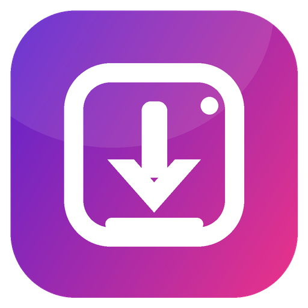

<div align="center">
  <a href="https://www.insta4dl.com/">
    
  </a>

  # Insta4DL for Android — Free Instagram Downloader APK

  **A lightweight Android WebView app for downloading publicly accessible Instagram Reels, videos, photos, stories and carousel posts through [Insta4DL.com](https://www.insta4dl.com/). No sign-up or Instagram login required.**

  [](https://github.com/emin3m68-hue/Insta4DL-Android/actions/workflows/build-apk.yml)
  
  
  

  **[Open Insta4DL Website](https://www.insta4dl.com/)** · **[Build / Get Android APK](https://github.com/emin3m68-hue/Insta4DL-Android/actions)** · **[View Source Code](https://github.com/emin3m68-hue/Insta4DL-Android)**
</div>

---

## What is Insta4DL for Android?

**Insta4DL** is a free Instagram downloader for Android, delivered as a lightweight native WebView wrapper around **[www.insta4dl.com](https://www.insta4dl.com/)**. It brings the mobile-friendly Insta4DL website into an Android app, making it easier to paste or share Instagram post links and save supported media to your phone.

Whether you want to save an **Instagram Reel**, download a **public Instagram video**, keep a **photo**, or access a supported **story or carousel**, the app provides a convenient way to use Insta4DL on your Android device.

**Important:** Insta4DL for Android uses the website's existing downloading functionality. Availability depends on the public post, website service and media source. It does not bypass Instagram logins, private-account restrictions or other access controls.

## Features

- **Free Instagram downloader:** Access Insta4DL without paying for the Android app or creating an account.
- **Instagram Reels and video downloads:** Open supported public Reels and video links using the Insta4DL website.
- **Instagram photo, story and carousel support:** Use the website's available download tools for compatible public media.
- **Share from Instagram:** Choose **Share → Insta4DL** on Android to send a link to the app.
- **One-tap paste:** Paste a copied Instagram URL from your clipboard into the website.
- **Save to Downloads:** Supported file downloads are saved under **`Downloads/Insta4DL`** using Android's download APIs.
- **Direct and in-browser downloads:** Supports HTTPS file downloads and compatible `blob:` downloads where the installed Android System WebView allows them.
- **Quick navigation:** Home, Paste, Files and Reload controls, plus Android Back navigation.
- **No additional app ads:** The Android wrapper does not add its own advertising SDK; content shown by the website is separate.
- **Minimal permissions:** The native Android project requests the **Internet** permission only.

## How to Download Instagram Reels, Videos and Photos on Android

1. Open the **Insta4DL** app on your Android phone.
2. Find a publicly accessible Instagram Reel, video, photo, story or carousel that the website supports.
3. Copy its link from Instagram, or use **Share → Insta4DL** if that option appears on your device.
4. Paste the URL into the Insta4DL website inside the app (or use the **Paste** shortcut).
5. Follow the website's **Download** instructions for the available media.
6. Open **Files** in the app or visit **`Downloads/Insta4DL`** on your device to find supported downloaded files.

> Some Instagram links or media formats may not be available. The app cannot retrieve private or otherwise inaccessible content, and individual results depend on Insta4DL.com.

## Download and Install the Android APK

This repository builds an **installable debug APK** through GitHub Actions. You do not need Android Studio to run the cloud build.

1. Open **[GitHub Actions — Insta4DL Android](https://github.com/emin3m68-hue/Insta4DL-Android/actions)**.
2. Select the **Build Insta4DL APK** workflow.
3. Open the latest successful run (green checkmark). If necessary, use **Run workflow** to create a new build.
4. Scroll to **Artifacts** and download **`Insta4DL-debug-APK`**. GitHub may ask you to sign in to download workflow artifacts.
5. Extract the downloaded ZIP file to find **`app-debug.apk`**.
6. Transfer the APK to your Android device and open it to install. If prompted, allow installation from the file manager or browser you are using.

**Android requirement:** Android 10 (API 29) or newer.

**Build type:** Debug APK, suitable for testing and direct installation. A signed release build is recommended for wider distribution or publication in an app store. GitHub Actions artifact links are temporary; for a permanent public APK link, publish a signed file under **[GitHub Releases](https://github.com/emin3m68-hue/Insta4DL-Android/releases)**.

## Build the APK from Source

### Option 1: GitHub Actions (recommended)

The repository contains **`.github/workflows/build-apk.yml`**, which uses Java 17, Gradle and the Android SDK available on GitHub's Ubuntu runner. Open the **Actions** tab and run **Build Insta4DL APK**. After a successful build, download the APK artifact.

### Option 2: Android Studio

1. Clone or download this repository.
2. Open the project in Android Studio.
3. Install any requested Android SDK components and sync Gradle.
4. Select **Build → Build Bundle(s) / APK(s) → Build APK(s)** (the menu wording may vary by Android Studio version).
5. Find the debug APK at **`app/build/outputs/apk/debug/app-debug.apk`**.

## Technical Details

| Setting | Value |
| --- | --- |
| Application ID | `com.insta4dl.app` |
| App version | `1.0.0` |
| Android minimum | API 29 (Android 10) |
| Target Android SDK | API 35 |
| Language | Java 17 |
| Gradle | 8.10.2 |
| Android Gradle Plugin | 8.7.3 |
| WebView dependency | AndroidX WebKit 1.14.0 |
| App permission | `android.permission.INTERNET` |
| Downloads folder | `Downloads/Insta4DL` |
| Website | [www.insta4dl.com](https://www.insta4dl.com/) |

### Project Structure

```text
Insta4DL-Android/
├── .github/workflows/build-apk.yml
├── app/
│   ├── build.gradle
│   └── src/main/
│       ├── AndroidManifest.xml
│       ├── assets/blob-bridge.js
│       └── java/com/insta4dl/app/MainActivity.java
├── build.gradle
├── gradle.properties
├── settings.gradle
├── ICON-512.png
└── README.md
```

The app displays the live website in Android WebView. It does not bundle a separate offline copy of Instagram media or the Insta4DL web service.

## Frequently Asked Questions

### Is Insta4DL for Android free?

Yes. The Android WebView app is free to use, and its core experience does not require user registration. Website features and availability remain subject to the Insta4DL service.

### Do I need to sign in to Instagram?

No Instagram login is required to use the Android wrapper for supported publicly accessible links. It cannot download content that requires private-account authorization.

### Can I download Instagram Reels on Android?

You can use the app to submit a public Instagram Reel link to Insta4DL.com. Whether a specific Reel can be downloaded depends on the website and the video's accessibility.

### Can I save Instagram photos, stories or carousel posts?

The app provides access to the photo, story and carousel tools available on the Insta4DL website. Support varies by media source and public accessibility.

### Where are downloaded files saved?

Supported downloads are stored in **`Downloads/Insta4DL`**. Tap **Files** in the app to open your phone's downloads view.

### Why is a download unavailable or incomplete?

Instagram may restrict access to media, or a public link may not expose a downloadable full-resolution file. Some large or in-browser-generated downloads also depend on your Android System WebView version and device resources. The Android wrapper cannot override those limitations.

### Can I install the APK without Google Play?

Yes. You can install the debug APK directly on a compatible Android device, subject to your device's installation security settings. A properly signed release APK is better for general distribution and consistent upgrades.

## Responsible Use and Disclaimer

Use Insta4DL only for media you own or are authorized to download, and respect copyright, privacy and platform rules. **Insta4DL is not affiliated with, endorsed by or sponsored by Instagram or Meta.** Instagram is a trademark of its respective owner.

The Android app is a WebView client for Insta4DL.com. The website handles its own online services and any website-level data processing; the native wrapper does not add a separate analytics SDK. Third-party media availability can change at any time.

## Website and Support

- **Official website:** [https://www.insta4dl.com/](https://www.insta4dl.com/)
- **Android source code:** [https://github.com/emin3m68-hue/Insta4DL-Android](https://github.com/emin3m68-hue/Insta4DL-Android)
- **Report Android app issues:** [GitHub Issues](https://github.com/emin3m68-hue/Insta4DL-Android/issues)

---

<div align="center">
  <strong>Insta4DL for Android — a free, convenient way to use the Insta4DL Instagram downloader on your phone.</strong>

  [Visit Insta4DL.com](https://www.insta4dl.com/)
</div>
