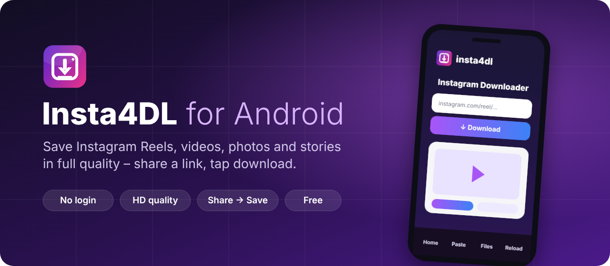

<div align="center">

<a href="https://www.insta4dl.com/"></a>

<br>

[](https://github.com/emin3m68-hue/Insta4DL-Android/actions/workflows/build-apk.yml)
[](https://github.com/emin3m68-hue/Insta4DL-Android/releases/latest)


**The official Android app for [Insta4DL.com](https://www.insta4dl.com/) – download public Instagram Reels, videos, photos, stories and carousels straight to your phone.**

[**⬇ Download the APK**](https://github.com/emin3m68-hue/Insta4DL-Android/releases/latest) &nbsp;·&nbsp; [Website](https://www.insta4dl.com/) &nbsp;·&nbsp; [Report a bug](https://github.com/emin3m68-hue/Insta4DL-Android/issues/new/choose)

</div>

---

## Highlights

<table>
<tr>
<td width="33%" valign="top">

### ↗ Share to save
In Instagram, tap **Share → Insta4DL**. The link opens in the app, ready to download.

</td>
<td width="33%" valign="top">

### 🔔 Story alerts
Turn on alerts for an account and get a notification the moment it posts a new story.

</td>
<td width="33%" valign="top">

### ↓ Saved where you expect
Downloads go straight to your phone's **Downloads** folder, with readable file names.

</td>
</tr>
<tr>
<td valign="top">

### ✦ Full quality
Reels and videos as HD MP4, photos at full size, whole carousels at once.

</td>
<td valign="top">

### 🔒 Private by design
No sign-up and no Instagram login. Only Internet access, plus notifications if you turn on alerts.

</td>
<td valign="top">

### ⚡ Fast, full-screen, always current
Runs on your browser's engine as a Trusted Web Activity – no address bar, no ads SDK, and new features arrive without updates.

</td>
</tr>
</table>

## Install

1. Open the **[latest release](https://github.com/emin3m68-hue/Insta4DL-Android/releases/latest)** and download `Insta4DL-x.y.z.apk` on your phone.
2. Open the file. If Android asks, allow installs from your browser or file manager.
3. Launch **Insta4DL** – that's it.

> **Requires Android 10 (API 29) or newer.** You can also install the app as a web app straight from [insta4dl.com/app](https://www.insta4dl.com/app/).

## How to use

| Step | What to do |
|---|---|
| **1. Find a post** | Any public Reel, video, photo, story or carousel on Instagram. |
| **2. Send it to the app** | **Share → Insta4DL**, or copy the link and paste it into the box. |
| **3. Download** | Pick the quality you want. The file is saved to your **Downloads** folder. |

Private accounts and content that needs a login can't be downloaded – the app never asks for your Instagram account.

## Build from source

```bash
git clone https://github.com/emin3m68-hue/Insta4DL-Android.git
cd Insta4DL-Android
./gradlew assembleDebug          # → app/build/outputs/apk/debug/app-debug.apk
```

You need **JDK 17** and the **Android SDK (API 35)**. Android Studio installs both and can open the project as is.

Every push to `main` is built by **[Android CI](https://github.com/emin3m68-hue/Insta4DL-Android/actions/workflows/build-apk.yml)**; the debug APK is attached to each run as an artifact.

<details>
<summary><strong>Publishing a release</strong></summary>

<br>

Push a version tag and CI builds a release APK and publishes it on the **Releases** page with generated notes:

```bash
git tag v1.1.0
git push origin v1.1.0
```

The version name comes from the tag (`v1.1.0` → `1.1.0`) and the version code from the CI run number.

To sign releases with your own key, add these repository secrets (**Settings → Secrets and variables → Actions**):

| Secret | Value |
|---|---|
| `KEYSTORE_BASE64` | Your `.jks` file, base64-encoded (`base64 -w0 release.jks`) |
| `KEYSTORE_PASSWORD` | Keystore password |
| `KEY_ALIAS` | Key alias |
| `KEY_PASSWORD` | Key password |

Without them the release APK is signed with the debug key: it installs fine, but keep using the same key once you start, or users will have to uninstall before updating.

</details>

<details>
<summary><strong>Technical details</strong></summary>

<br>

| Setting | Value |
|---|---|
| Application ID | `com.insta4dl.app` |
| Min / target SDK | 29 (Android 10) / 35 |
| Language | Java 17 |
| App type | Trusted Web Activity ([android-browser-helper](https://github.com/GoogleChrome/android-browser-helper) 2.5.0) |
| Build | Gradle 8.10.2 (wrapper) · Android Gradle Plugin 8.7.3 |
| Fallback | In-app WebView when no TWA-capable browser is installed |
| Permissions | `INTERNET`, `POST_NOTIFICATIONS` (story alerts) |
| Domain verification | `https://www.insta4dl.com/.well-known/assetlinks.json` |

```text
Insta4DL-Android/
├── app/src/main/
│   ├── AndroidManifest.xml                       TWA launcher, share target, notifications
│   └── res/                                      adaptive icon, splash, theme, strings
├── docs/assets/                                  banner, icon, social preview
├── .github/workflows/build-apk.yml               CI and releases
└── gradlew                                       Gradle wrapper
```

The app opens insta4dl.com full-screen in the browser engine (Chrome, Samsung Internet, Edge…). Because the website vouches for the app through Digital Asset Links, no address bar is shown, and web push, downloads and the site's features work exactly as on the web.

</details>

## FAQ

<details>
<summary><strong>Is it free?</strong></summary>
<br>
Yes. No account, no subscription, and the app adds no advertising SDK of its own.
</details>

<details>
<summary><strong>Do I need to log in to Instagram?</strong></summary>
<br>
No. The app works with public posts and never asks for your Instagram account.
</details>

<details>
<summary><strong>Where are my downloads?</strong></summary>
<br>
In your phone's <b>Downloads</b> folder (open the <b>Files</b> app → Downloads).
</details>

<details>
<summary><strong>A download doesn't work – what now?</strong></summary>
<br>
Try the same link on <a href="https://www.insta4dl.com/">insta4dl.com</a>. If it fails there too, the post is probably private, deleted or age-restricted. If it only fails in the app, please <a href="https://github.com/emin3m68-hue/Insta4DL-Android/issues/new/choose">open an issue</a> with your device and Android version.
</details>

<details>
<summary><strong>Do I need Chrome?</strong></summary>
<br>
No. Chrome, Samsung Internet, Edge and other modern browsers run the app full-screen. Without one of them it falls back to a built-in WebView, which works too (story alerts need a browser).
</details>

<details>
<summary><strong>Why isn't it on Google Play?</strong></summary>
<br>
Apps that download from social networks are often removed from Google Play, so Insta4DL is distributed as an APK through GitHub Releases and as a web app on <a href="https://www.insta4dl.com/app/">insta4dl.com/app</a>.
</details>

## Responsible use

Download only content you own or have permission to use, and respect creators' rights and Instagram's terms.
Insta4DL is an independent project and is **not affiliated with, endorsed or sponsored by Instagram or Meta**. Instagram is a trademark of its owner.

## License

[MIT](LICENSE) © Insta4DL. The app's code is open source; the insta4dl.com website and service it opens are not part of this repository.

---

<div align="center">
<sub>Made for <a href="https://www.insta4dl.com/">insta4dl.com</a> · <a href="CHANGELOG.md">Changelog</a> · <a href="LICENSE">MIT License</a> · <a href="https://github.com/emin3m68-hue/Insta4DL-Android/issues">Issues</a></sub>
</div>
